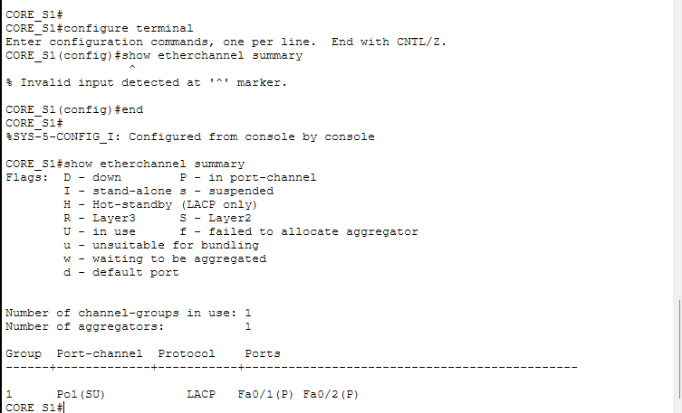
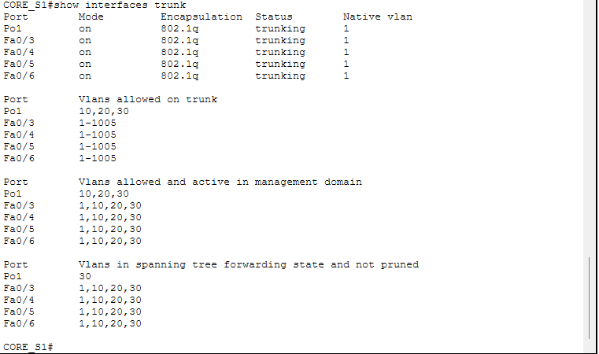

# LACP EtherChannel Lab: Redundant Core Switches with Inter-VLAN Routing and DHCP

A Cisco Packet Tracer lab that bundles two physical links between a pair of core switches into a single logical **LACP (IEEE 802.3ad) EtherChannel**, carries multiple VLANs across it as a trunk, and uses a **router-on-a-stick** to provide inter-VLAN routing and centralized DHCP.

## Objectives

- Combine multiple physical links into one logical link for extra bandwidth and link redundancy
- Negotiate the bundle dynamically with **LACP** instead of hard-coding it
- Trunk VLANs 10, 20 and 30 over the EtherChannel
- Route between VLANs using a router with 802.1Q subinterfaces
- Hand out addresses to each VLAN from DHCP pools on the router

## Topology


| Device                    | Model    | Role                                                    |
|---------------------------|----------|---------------------------------------------------------|
| Router0 (`Router`)        | 2911     | Inter-VLAN routing (router-on-a-stick) and DHCP server  |
| CORE_S1                   | 2960-24TT | Core switch 1, one end of the LACP EtherChannel        |
| CORE_S2 (labelled Switch4)| 2960-24TT | Core switch 2, other end of the LACP EtherChannel      |
| Switch0, Switch1, Switch2 | 2960-24TT | Access switches, each dual-homed to both core switches |
| PC0 to PC5                | PC-PT    | End hosts, two per access switch                        |

**Links**

- **Core to core:** two links between CORE_S1 and CORE_S2 (`Fa0/1` and `Fa0/2` on each) bundled into `Port-channel1` using LACP
- **Access to core:** every access switch has an uplink to each core switch, so losing one core does not isolate any access switch
- **Router to core:** Router0 has one uplink to each core switch; only `Gi0/0` is configured (with the VLAN subinterfaces), and `Gi0/1` has no configuration
- **Hosts:** two PCs per access switch

## Addressing Plan

| VLAN | Subnet            | Gateway (router subinterface) | DHCP Pool |
|------|-------------------|-------------------------------|-----------|
| 10   | 192.168.10.0/24   | 192.168.10.1 (`Gi0/0.10`)     | LAN1      |
| 20   | 192.168.20.0/24   | 192.168.20.1 (`Gi0/0.20`)     | LAN2      |
| 30   | 192.168.30.0/24   | 192.168.30.1 (`Gi0/0.30`)     | LAN3      |

DNS server handed out by all pools: `8.8.8.8`. The gateway address (`.1`) is excluded from each pool.

## How It Works

### 1. LACP EtherChannel (both core switches)

Both ends use `channel-group 1 mode active`, so each side actively initiates LACP negotiation. Once the members agree, the switches treat `Fa0/1` and `Fa0/2` as one logical interface, `Port-channel1`, which is configured as a trunk.

```
interface Port-channel1
 switchport mode trunk
 switchport trunk allowed vlan 10,20,30      ! CORE_S2: vlan 10,20

interface FastEthernet0/1
 switchport mode trunk
 switchport trunk allowed vlan 10,20,30      ! CORE_S2: vlan 10,20
 channel-group 1 mode active

interface FastEthernet0/2
 switchport mode trunk
 switchport trunk allowed vlan 10,20,30      ! CORE_S2: vlan 10,20
 channel-group 1 mode active
```

Member ports must share the same trunk settings (mode and allowed VLANs), otherwise the bundle will not form or ports will be suspended.

> **Note:** VLAN 30 is allowed on `CORE_S1`'s Port-channel but not on `CORE_S2`'s (VLANs 10 and 20 only), so VLAN 30 traffic is not carried to the CORE_S2 side of the bundle.

Ports `Fa0/3` to `Fa0/6` on both core switches are set to trunk mode with no VLAN restriction, for the links to the three access switches and the router.

### 2. Router-on-a-stick

A single physical router interface is split into one subinterface per VLAN using 802.1Q encapsulation, and each subinterface acts as that VLAN's default gateway.

```
interface GigabitEthernet0/0
 no ip address

interface GigabitEthernet0/0.10
 encapsulation dot1Q 10
 ip address 192.168.10.1 255.255.255.0

interface GigabitEthernet0/0.20
 encapsulation dot1Q 20
 ip address 192.168.20.1 255.255.255.0

interface GigabitEthernet0/0.30
 encapsulation dot1Q 30
 ip address 192.168.30.1 255.255.255.0
```

### 3. DHCP on the router

```
ip dhcp excluded-address 192.168.10.1
ip dhcp excluded-address 192.168.20.1
ip dhcp excluded-address 192.168.30.1

ip dhcp pool LAN1
 network 192.168.10.0 255.255.255.0
 default-router 192.168.10.1
 dns-server 8.8.8.8
! LAN2 and LAN3 follow the same pattern for VLANs 20 and 30
```

## Verification

Run these on the core switches:

```
show etherchannel summary
show etherchannel port-channel
show interfaces trunk
show spanning-tree
```

What to look for:

- `show etherchannel summary`: `Po1` flagged **SU** (Layer 2, in use), protocol **LACP**, members `Fa0/1` and `Fa0/2` flagged **P** (bundled in port-channel)
- `show interfaces trunk`: `Port-channel1` listed as a trunk with the expected allowed VLANs
- `show spanning-tree`: the port-channel is treated as a single logical port, not two separate links

On the router:

```
show ip dhcp binding
show ip interface brief
```

From end devices, confirm they receive an address from the correct pool and can ping their gateway and hosts in the other VLANs.

Screenshots:




## Failover Test

1. Start a continuous ping (`ping -t`) between two hosts on different access switches, e.g. PC0 to PC4.
2. Shut down one bundle member, e.g. `interface Fa0/1` then `shutdown`, on one switch.
3. Confirm the ping continues (at most a brief blip) and `show etherchannel summary` shows only one active member.
4. Bring the port back with `no shutdown` and confirm both members return to **P**.

## Troubleshooting Notes

| Symptom                                | Likely cause                                                                 |
|----------------------------------------|------------------------------------------------------------------------------|
| Port-channel shows **SD** (down)       | No LACP partner: mode mismatch (e.g. `passive`/`passive`) or cable issue     |
| Member ports shown as **I** or **s**   | Members have different trunk, speed or duplex settings                       |
| Hosts do not get an IP                 | VLAN not allowed on the trunk path, or router subinterface not up            |
| One VLAN unreachable across the bundle | VLAN missing from the trunk's allowed list on one side                       |

## Possible Improvements

Not implemented in this lab, but natural next steps:

- Set an explicit STP root bridge and secondary (`spanning-tree vlan 10,20,30 root primary`); with dual-homed access switches and no priorities set, the root is chosen by MAC address and could end up on an access switch
- Restrict allowed VLANs on the access-switch uplinks (`Fa0/3` to `Fa0/6`) and shut down unused ports
- Add management VLAN, SSH and passwords for the VTY lines
- Enable PortFast and BPDU Guard on access ports
- Configure the router's second uplink (`Gi0/1`) or use a Layer 3 switch pair for gateway redundancy

## Repository Structure

```
.
├── README.md
├── lacp-etherchannel-lab.pkt
├── images/
│   ├── topology.png
│   ├── etherchannel-summary.png
│   └── trunk-status.png
└── configs/
    ├── CORE_S1.txt
    ├── CORE_S2.txt
    ├── Router.txt
    └── (access switch configs)
```

## Tools

- Cisco Packet Tracer
- Cisco IOS CLI
